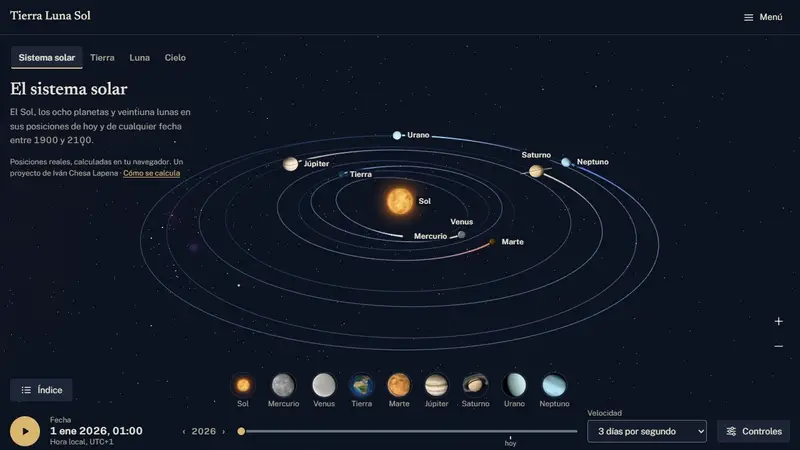
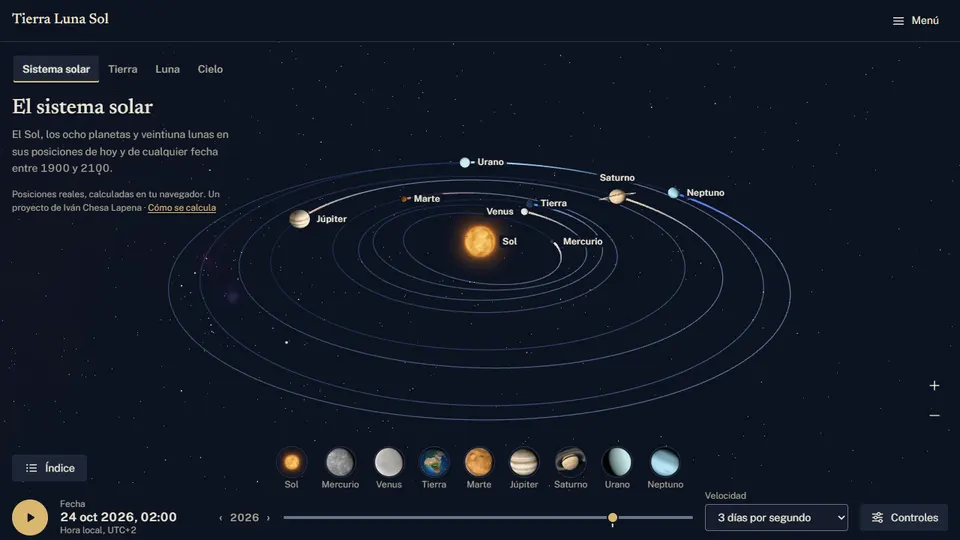
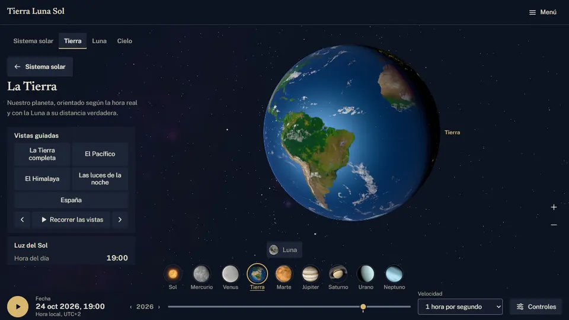
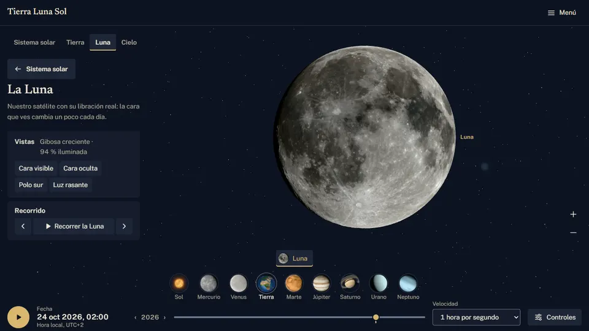
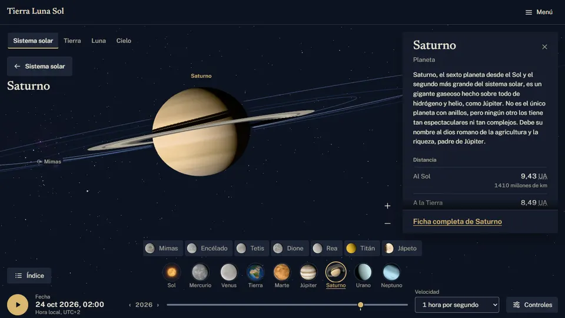
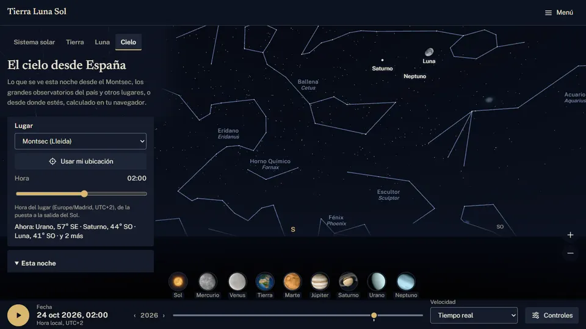
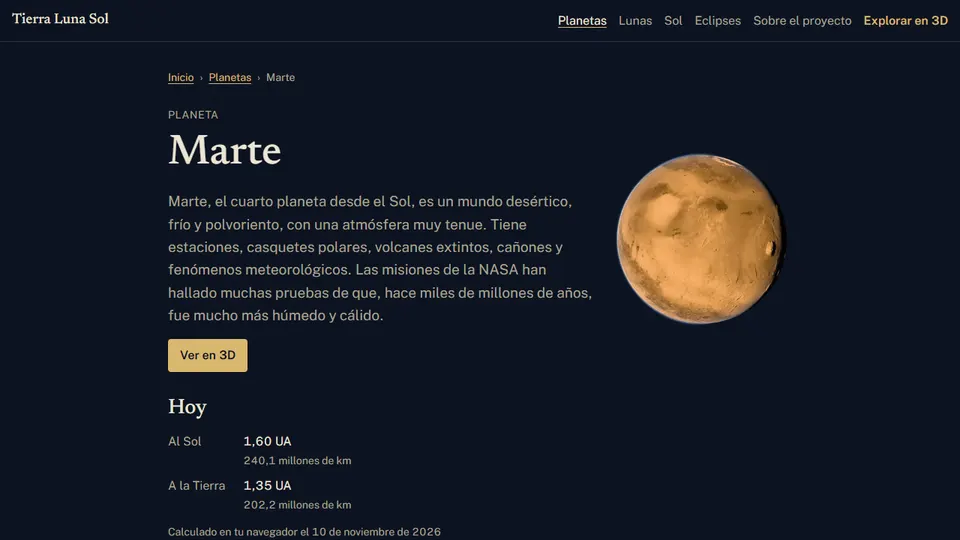
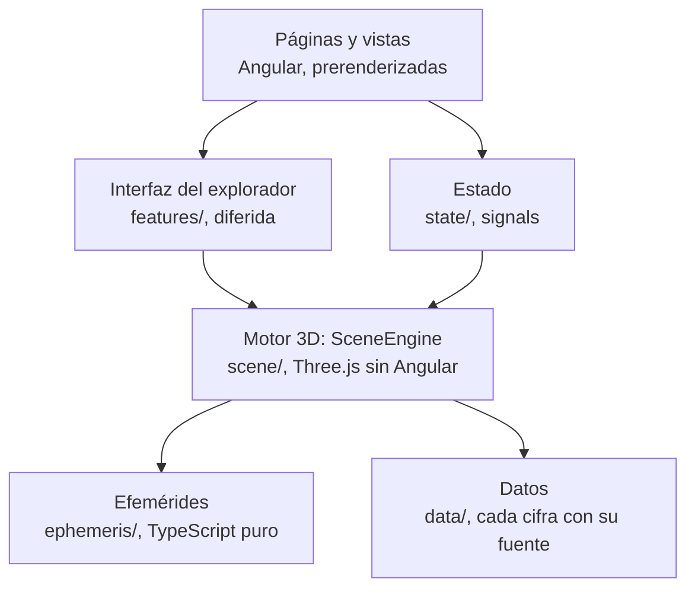

# Tierra Luna Sol

Explorador 3D del Sol, los ocho planetas y veintiuna lunas, en español, con sus posiciones y orientaciones reales para cualquier fecha entre 1900 y 2100, calculadas en el navegador.

**[tierra-luna-sol.ivanchesa.com](https://tierra-luna-sol.ivanchesa.com)** · Hecho por [Iván Chesa Lapena](https://ivanchesa.com), desarrollador de software.

## Qué hace

- **El sistema solar en movimiento**, con viajes de cámara continuos entre la vista general, la Tierra, la Luna y el cielo, en un solo lienzo 3D.
- **La Tierra** con su relieve, sus nubes y las luces de la noche, y cinco vistas guiadas. **La Luna** con el relieve del altímetro LOLA, su libración y un recorrido.
- **Las lunas principales** con sus mosaicos del USGS (y lo que ninguna sonda fotografió, recreado y explicado), las sombras de las lunas sobre Júpiter y los anillos de Saturno con su opacidad medida por Cassini.
- **El cielo desde España** (el Montsec por defecto, seis lugares más o tu ubicación, que no sale del navegador): los crepúsculos, la refracción, las constelaciones y qué planetas se ven esta noche. Y **los próximos eclipses** visibles desde España.
- **Las fichas de los 30 cuerpos**, en HTML prerenderizado, con cada dato enlazado a su fuente.
- **Todo con teclado y sin 3D**: listas, tablas y fichas equivalentes a lo que se hace en el lienzo, y movimiento reducido en todas las animaciones.

| | |
|---|---|
|  |  |
|  |  |
|  |  |

Las capturas son del propio explorador en el modo de captura determinista (`?captura=1`).

## Stack

- **Angular 22**: componentes independientes, signals y sin zone.js; las 40 páginas se prerenderizan y se leen sin JavaScript.
- **Three.js 0.186**, directo y sin envoltorios, con shaders GLSL propios: sombreado por tipo de cuerpo, atmósferas, sombras de eclipses y de anillos analíticas y profundidad logarítmica.
- **astronomy-engine** para el Sol, los planetas, la Luna, las lunas de Júpiter, las orientaciones, las salidas y puestas y los eclipses; las otras dieciséis lunas, con elementos orbitales ajustados a JPL Horizons.
- **TypeScript estricto** (sin `any`) y **CSS propio** con custom properties, sin bibliotecas de interfaz.
- **Pruebas:** Vitest (835 tests; cobertura de las efemérides, 98,9 %), Playwright (151 e2e con regresión visual), axe en todas las rutas y Lighthouse CI.
- **Despliegue:** Cloudflare Pages desde GitHub Actions, con el build verificado por el CI y sin builds en Cloudflare.

## Arquitectura

- **Capas vigiladas por el lint:** `three` solo se importa en `scene/`, que no conoce Angular; `ephemeris/` es TypeScript puro y toda conversión de coordenadas u orientación vive en dos módulos con tests.
- **Un solo lienzo y un solo renderer** para todas las vistas del explorador; el motor no se recrea al cambiar de vista.
- **Pintado bajo demanda:** sin movimiento no se pinta nada, y el ritmo de pintado sigue al movimiento en pantalla. El bucle va fuera de Angular y la interfaz se actualiza como mucho cinco veces por segundo.
- **Marcos de escala:** las posiciones se calculan en 64 bits y llegan a la GPU relativas al cuerpo enfocado (origen flotante), en tres marcos: la vista general ilustrativa, el sistema local físico y la escala real.
- **Nada pesado en el JS inicial:** `three` y `astronomy-engine` se cargan cuando hacen falta; un script del CI lo comprueba en cada página.
- **Texturas por niveles de calidad**, decodificadas fuera del hilo principal, subidas a la GPU poco a poco y liberadas al cambiar de vista.

El plan completo, con sus decisiones, está en [`docs/PLAN.md`](docs/PLAN.md), y cada fase tiene su informe en [`docs/informes/`](docs/informes/) y su revisión en [`docs/revisiones/`](docs/revisiones/).

## Precisión medida

| Qué | Frente a | Error máximo | Informe |
|---|---|---|---|
| Planetas, de 1900 a 2100 | JPL Horizons | 0,008° | [Fase 1](docs/informes/fase-1.md) |
| La Luna | JPL Horizons | 0,002° | [Fase 1](docs/informes/fase-1.md) |
| Las lunas de Júpiter | JPL Horizons | 0,06° | [Fase 1](docs/informes/fase-1.md) |
| Las otras 16 lunas, de 1900 a 2100 | JPL Horizons | 0,38° | [Fase 1](docs/informes/fase-1.md) |
| La libración de la Luna y la apertura de los anillos | JPL Horizons | 0,005° y 0,004° | [Revisión de la fase 2](docs/revisiones/fase-2.md) |
| El centro de la sombra del eclipse del 12-08-2026 | NASA | 2,7 km | [Fase 5](docs/informes/fase-5.md) |
| La sombra de la Tierra en tres eclipses de Luna | NASA | 0,001 de magnitud | [Fase 6](docs/informes/fase-6.md) |
| Salidas, puestas y crepúsculos en el Montsec y el Teide | USNO | 2 min | [Fase 8](docs/informes/fase-8.md) |
| Los 45 eclipses de 2026 a 2035 | NASA | Fecha y tipo exactos | [Fase 8](docs/informes/fase-8.md) |

## Rendimiento medido

En un PC de escritorio con una RTX 3060 (detalle y método en el [informe de la fase 10](docs/informes/fase-10.md) y, en producción, en el [de la fase 11](docs/informes/fase-11.md)).

| Qué | Medido | Presupuesto |
|---|---|---|
| Imágenes por segundo, en todas las vistas y niveles de calidad | 59–60 | ≥ 55 |
| Memoria de vídeo de la vista Tierra (nivel alto y bajo) | 278 y 86 MB | 300 y 120 MB |
| Las posiciones y orientaciones de los 30 cuerpos, por imagen | 0,17–0,19 ms | 2 ms |
| JS inicial en bruto (y código propio en él) | 319,7 kB (14,0 kB) | 400 kB (15 kB) |
| Tarea más larga del arranque | 144 ms | 200 ms |
| Desplazamiento al cargar (CLS) | 0 | 0,05 |
| Imágenes pintadas en reposo | 0 | — |

## Privacidad

Sin cookies, sin analítica y sin peticiones a otros dominios: las fuentes, las texturas y los datos se sirven desde el propio sitio. El navegador solo guarda preferencias, y la ubicación, si se pide, no sale de él.

## Comandos

- `npm start`: servidor de desarrollo.
- `npm test`: tests unitarios (Vitest).
- `npm run lint`: ESLint y Prettier.
- `npm run build`: build con prerenderizado, listo para Cloudflare Pages (`scripts/prepare-pages.mjs`: rutas sin barra final, `404.html`, la CSP de `public/_headers`, `robots.txt` y `sitemap.xml`).
- `npm run check`: lint, tests con el umbral de cobertura, build, el JS inicial sin librerías pesadas y los enlaces internos.
- `npm run e2e`: e2e con Playwright sobre el build (Chromium con WebGL).

## Despliegue

En Cloudflare Pages, desde GitHub Actions:

- **Vistas previas** (`.github/workflows/ci.yml`): cada push con el CI en verde (lint, tests, build, e2e y Lighthouse) publica el build verificado en `<rama>.tierra-luna-sol.pages.dev`; el de `main`, en `staging.tierra-luna-sol.pages.dev`.
- **Producción** (`.github/workflows/deploy-production.yml`): una etiqueta `v*` publica en [tierra-luna-sol.ivanchesa.com](https://tierra-luna-sol.ivanchesa.com) el mismo build que verificó el CI para ese commit, y `scripts/verify-pages.mjs` comprueba la publicación (rutas, 404, cabeceras, sin cookies ni NEL, el sitemap y el HTML servido idéntico al del build).

## Licencia

El código propio tiene licencia [MIT](LICENSE) (© 2026 Iván Chesa Lapena).

Las texturas, los datos y los catálogos de terceros **conservan sus propias licencias**, que se detallan archivo a archivo en [`docs/FUENTES.md`](docs/FUENTES.md) y en la página [`/creditos`](https://tierra-luna-sol.ivanchesa.com/creditos); las capturas de este README los muestran. En particular, el catálogo de estrellas (`public/data/stars.bin`, derivado de la HYG Database v4.1) tiene licencia CC BY-SA 4.0, y las texturas de Solar System Scope, CC BY 4.0.
