<!-- GENERADO por scripts/build-textures.mjs el 2026-11-09. No se edita a mano. -->

# Las lunas recreadas (D45, fase 9b; D48, entrega 10.a)

Lo que no se vio de cada luna, recreado a partir del terreno real de la misma luna, y el detalle que falta en lo visto de lejos (`scripts/lib/moon-recreate.mjs`, con la receta de `scripts/lib/moon-recipes.mjs`). Es **ilustrativo**. Las clases, medidas en el mapa de 2k (`scripts/measure-moon-maps.mjs`, con la máscara de cobertura umbralizada antes de reducir, D48): lo real con detalle, lo real con luz rasante (D48, `scripts/lib/moon-grazing.mjs`), lo visto de lejos (una resolución de origen más gruesa que la de la textura) y lo no visto. Los porcentajes, por el área de la esfera.

- **Real con luz rasante** (D48): la franja de lo real junto al terminador de las imágenes de la Voyager 2 (en las lunas de Urano; entre paréntesis, su anchura, medida en el perfil del brillo de lo real por distancia a lo no visto) y la unión de 180° de los mapas del JPL (su última columna, más oscura). Su brillo a gran escala se lleva al de lo real vecino y, en la franja del terminador, sus sombras se funden hacia lo recreado. Lo demás de lo real, igual byte a byte.
- **Grano:** el paso alto de L* de lo recreado junto a lo real frente al de lo real vecino (del 0.7 al 1.3).
- **Borde fino** (σ = 4 texeles): la diferencia del brillo medio de cada lado del borde de lo real intacto con cada clase, por teselas de 64 texeles: el percentil 95, el máximo y, entre paréntesis, las teselas. D48: como mucho 2 L* por encima de lo natural (bordes ficticios dentro de lo real intacto, con la máscara girada 90°, 180° y 270°; con lo visto de lejos, del mayor de lo natural y del salto del mosaico original).
- **Borde medio** (σ = 16 texeles, unos 2,8°): lo mismo, a la escala del brillo medio. D48: ΔL* ≤ 2 en el percentil 95 en el borde con lo no visto y con lo real con luz rasante (lo que pone la recreación). Lo natural a esa escala no baja de 2 en la mayoría de las lunas (ni a ninguna escala de 0,7° a 17°): su terreno tiene manchas de albedo de ese tamaño.
- **Contraste:** la desviación típica del L* de lo no visto a gran escala (σ = 8 texeles, entre ±60°) frente a la de lo real. D48: del 0.7 al 1.3 en las lunas de Urano.
- **Lo real en el WebP:** el error medio absoluto (niveles de 0 a 255) de lo real en la textura de 2k frente al mosaico; entre paréntesis, el del mosaico comprimido igual sin recrear.
- **Máscara:** lo real, sin tinte; lo real con luz rasante, en ámbar; lo visto de lejos, en rojo; lo no visto (recreado entero), en azul.

| Luna | Real | Real con luz rasante | Visto de lejos | No visto | Receta | Grano | Borde fino, p95 · máx. (teselas) | Natural, fino | Borde medio, p95 · máx. (teselas) | Natural, medio | Contraste | Lo real en el WebP | Máscara |
|---|---|---|---|---|---|---|---|---|---|---|---|---|---|
| phobos | 91,8 % | 0,0 % | 8,2 % | 0,0 % | la de por defecto | 1,03 | de lejos 5,46 · 9,39 (102) | 5,46 · 11,94 (293) | de lejos 9,70 · 18,06 (92) | 7,75 · 14,71 (251) | — | 2,59 (2,59) |  |
| io | 82,9 % | 0,0 % | 17,1 % | 0,0 % | la de por defecto | 0,99 | de lejos 2,63 · 6,35 (159) | 5,01 · 18,26 (429) | de lejos 5,81 · 10,99 (149) | 6,46 · 11,90 (391) | — | 2,28 (2,29) |  |
| europa | 80,0 % | 0,0 % | 19,4 % | 0,6 % | la de por defecto | 0,98 | de lejos 1,60 · 2,21 (121) | 3,24 · 8,73 (314) | de lejos 4,68 · 7,60 (119) | 3,78 · 5,63 (301) | — | 2,95 (3,03) | 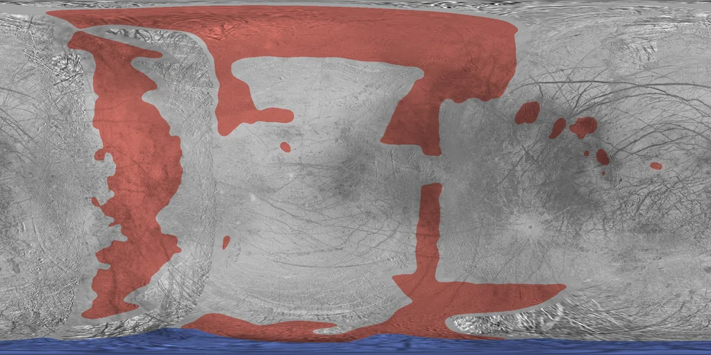 |
| ganymede | 97,9 % | 0,0 % | 1,6 % | 0,5 % | la de por defecto | 0,98 | de lejos 2,24 · 3,72 (33) | 2,56 · 5,12 (99) | de lejos 9,75 · 9,95 (24) | 5,12 · 9,36 (72) | — | 2,42 (2,46) | 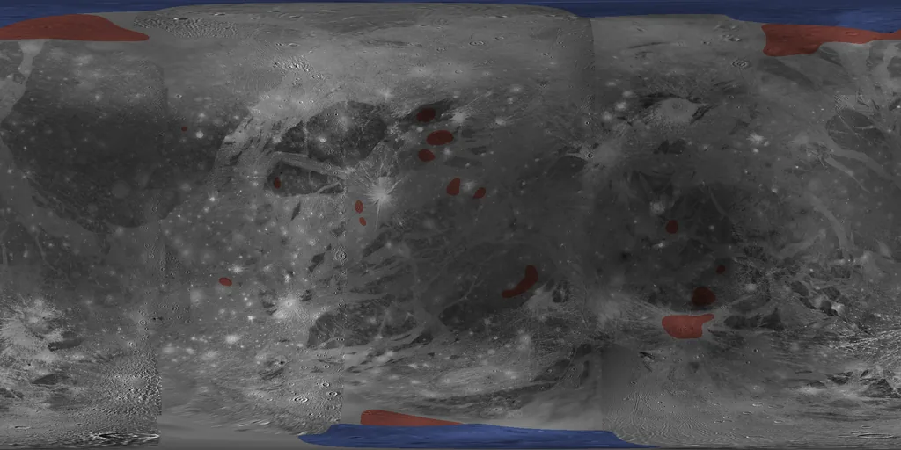 |
| callisto | 87,5 % | 0,0 % | 11,5 % | 1,0 % | la de por defecto | 1,00 | de lejos 4,13 · 7,69 (81) | 3,26 · 6,68 (214) | de lejos 8,12 · 15,94 (76) | 5,11 · 9,17 (195) | — | 2,69 (2,74) | 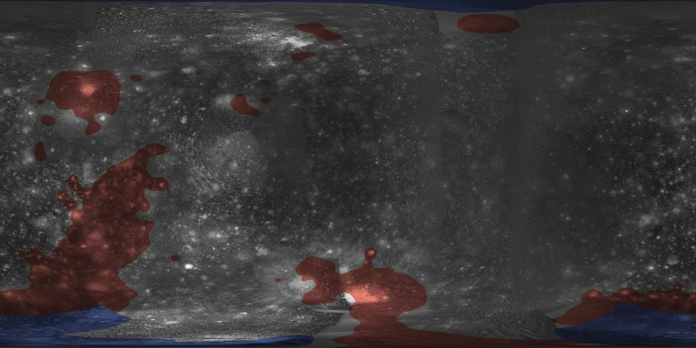 |
| mimas | 80,0 % | 0,0 % | 20,0 % | 0,0 % | la de por defecto | 0,97 | de lejos 8,87 · 13,69 (108) | 9,25 · 19,23 (270) | de lejos 7,45 · 15,85 (107) | 5,43 · 11,81 (263) | — | 2,49 (2,57) | 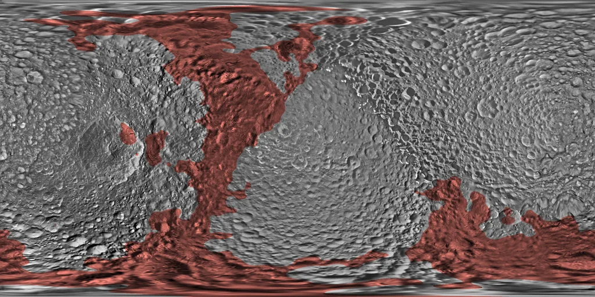 |
| enceladus | 74,2 % | 0,0 % | 25,8 % | 0,0 % | la de por defecto | 0,99 | de lejos 3,49 · 6,40 (144) | 2,49 · 12,17 (315) | de lejos 3,40 · 4,89 (143) | 2,20 · 4,83 (304) | — | 3,11 (3,21) | 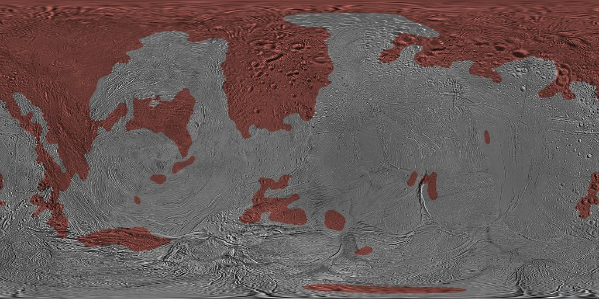 |
| tethys | 79,9 % | 0,0 % | 20,1 % | 0,0 % | la de por defecto | 0,98 | de lejos 4,98 · 8,67 (134) | 5,13 · 15,70 (307) | de lejos 4,28 · 7,20 (132) | 3,44 · 8,83 (283) | — | 3,02 (3,11) |  |
| dione | 87,3 % | 0,0 % | 12,7 % | 0,0 % | la de por defecto | 0,98 | de lejos 3,62 · 5,17 (95) | 6,09 · 12,69 (269) | de lejos 5,49 · 8,68 (88) | 3,20 · 8,86 (245) | — | 3,13 (3,16) | 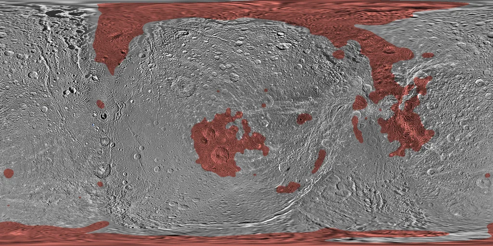 |
| rhea | 92,6 % | 0,0 % | 7,4 % | 0,0 % | la de por defecto | 0,97 | de lejos 3,20 · 5,19 (74) | 6,02 · 13,48 (208) | de lejos 3,21 · 3,63 (70) | 2,85 · 6,83 (192) | — | 2,69 (2,70) |  |
| iapetus | 69,2 % | 0,0 % | 30,8 % | 0,0 % | la de por defecto | 0,98 | de lejos 4,04 · 11,13 (114) | 5,38 · 23,71 (257) | de lejos 8,22 · 12,53 (113) | 6,27 · 11,27 (242) | — | 2,83 (2,94) | 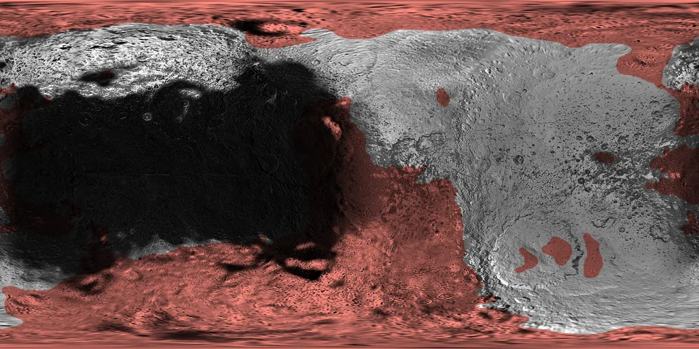 |
| triton | 30,2 % | 0,0 % | 36,3 % | 33,5 % | el casquete de Tritón | 1,00 | no visto 1,53 · 1,76 (14); de lejos 3,63 · 4,75 (70) | 4,53 · 7,51 (78) | no visto 0,33 · 0,35 (14); de lejos 6,79 · 8,10 (67) | 4,54 · 11,27 (72) | 0,62 | 2,95 (3,29) | 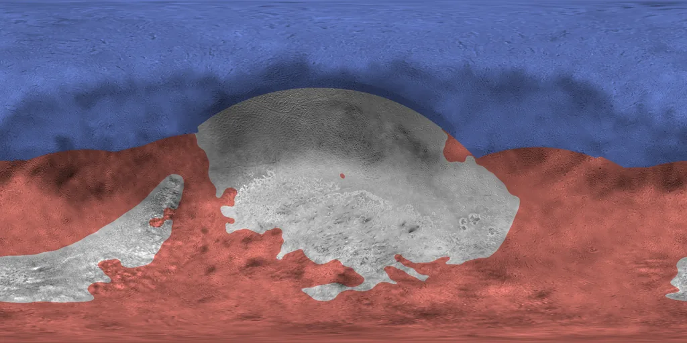 |
| deimos | 55,0 % | 0,5 % | 32,7 % | 11,8 % | la de por defecto | 1,14 | no visto 4,96 · 5,31 (19); luz rasante 3,90 · 4,78 (12); de lejos 2,89 · 4,13 (202) | 3,37 · 7,76 (403) | no visto 0,96 · 1,22 (17); luz rasante 1,82 · 2,58 (12); de lejos 7,07 · 12,98 (201) | 5,92 · 11,24 (367) | 0,70 | 1,29 (1,28) | 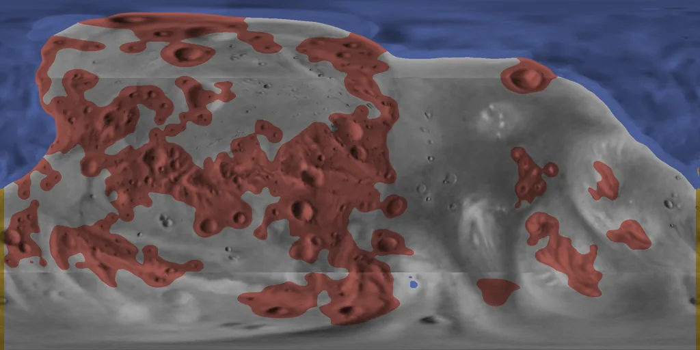 |
| miranda | 27,3 % | 6,7 % (7,0°) | 5,3 % | 60,7 % | la de Miranda | 0,99 | luz rasante 2,83 · 3,38 (28); de lejos 6,77 · 10,53 (67) | 4,89 · 21,73 (182) | luz rasante 1,19 · 1,98 (28); de lejos 6,46 · 11,13 (62) | 5,88 · 13,31 (159) | 0,90 | 1,76 (1,85) | 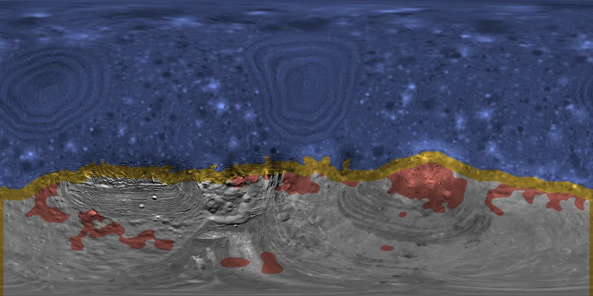 |
| ariel | 21,9 % | 2,4 % (2,5°) | 8,8 % | 66,8 % | la de Ariel | 1,01 | luz rasante 0,81 · 1,08 (22); de lejos 2,88 · 3,29 (53) | 2,07 · 5,63 (113) | luz rasante 0,25 · 0,31 (23); de lejos 3,05 · 3,79 (48) | 1,58 · 2,99 (103) | 0,90 | 1,50 (1,58) | 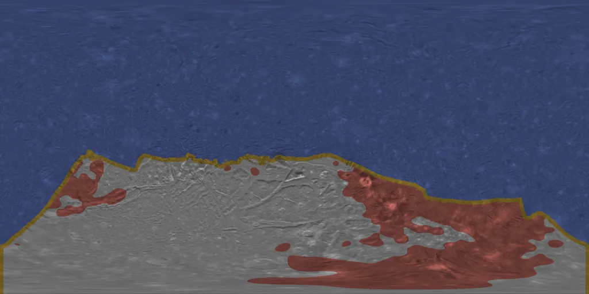 |
| umbriel | 29,3 % | 6,0 % (6,5°) | 1,0 % | 63,7 % | la de Umbriel | 1,13 | luz rasante 1,56 · 2,05 (37); de lejos 1,63 · 2,49 (16) | 2,51 · 4,34 (78) | luz rasante 0,48 · 0,73 (36); de lejos 2,88 · 3,89 (17) | 2,60 · 4,38 (74) | 0,90 | 1,02 (1,05) | 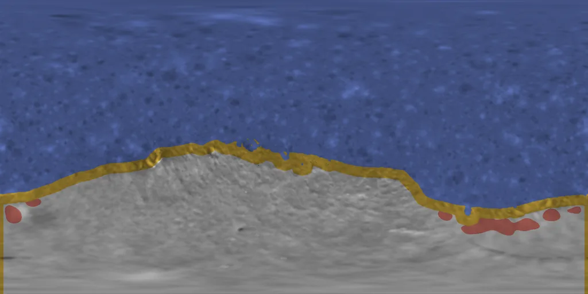 |
| titania | 25,8 % | 5,0 % (5,5°) | 0,3 % | 68,9 % | la de Titania | 0,99 | luz rasante 2,65 · 3,90 (41); de lejos 3,03 · 3,03 (3) | 6,61 · 7,82 (71) | luz rasante 1,00 · 2,46 (41); de lejos 5,75 · 5,75 (3) | 8,38 · 12,88 (68) | 0,90 | 1,75 (1,99) | 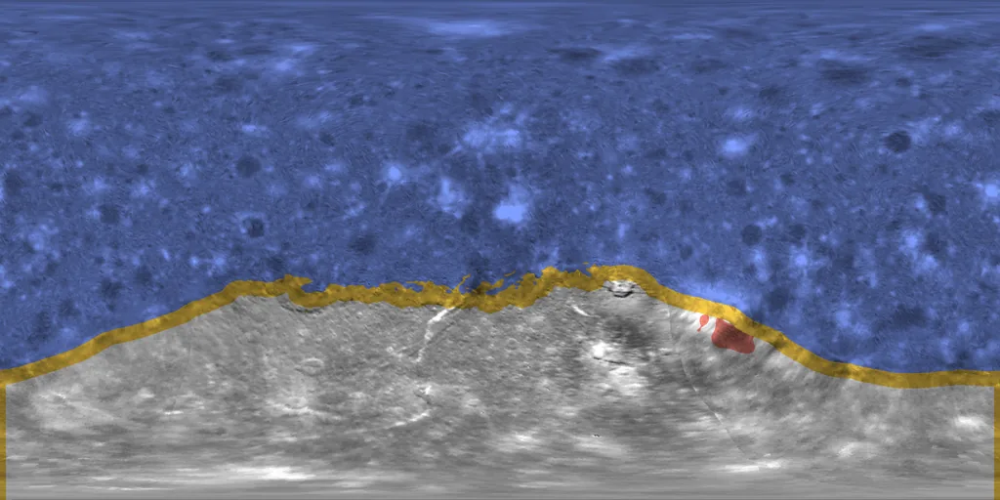 |
| oberon | 29,9 % | 3,5 % (4,0°) | 0,0 % | 66,5 % | la de Oberón | 1,26 | luz rasante 3,00 · 4,30 (40); de lejos 0,80 · 0,80 (4) | 8,08 · 19,61 (74) | luz rasante 0,91 · 1,39 (40) | 14,53 · 24,71 (63) | 0,89 | 1,40 (1,52) | 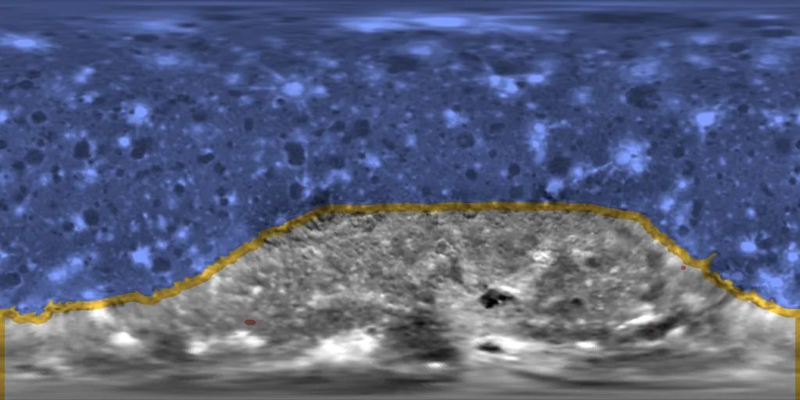 |

## Los cráteres y las coronas de lo no visto (D48)

En las lunas de Urano, lo no visto lleva cráteres con la población y el albedo de su real (`scripts/lib/moon-craters.mjs`): las manchas claras y oscuras de lo real, por escala (de unos 0,4° a 5°), con su densidad y su contraste; las oscuras, cráteres de fondo oscuro y borde claro, y las claras, con su halo y, las más claras de las grandes, con rayos; una parte, difusas. El factor común lleva el contraste a gran escala de lo no visto al de lo real. En Miranda, además, dos coronas ilustrativas, con las bandas de su terreno bandeado real.

| Luna | Cráteres | Factor | Coronas | Contraste: real · no visto → cociente |
|---|---|---|---|---|
| miranda | 5301 | 1,18 | 2 (bandas de 2,1°, 10,9 L*) | 4,97 · 4,47 → 0,90 |
| ariel | 8529 | 0,68 | — | 1,08 · 0,97 → 0,90 |
| umbriel | 4509 | 1,30 | — | 2,40 · 2,16 → 0,90 |
| titania | 8205 | 1,06 | — | 6,44 · 5,79 → 0,90 |
| oberon | 4332 | 1,18 | — | 9,44 · 8,43 → 0,89 |

## El borde del casquete del norte de Tritón

El del sur, medido donde lo vio la Voyager 2 (922 columnas del mapa de 2k; su latitud media, -2,7°; la transición de brillo, de un cuarto a tres cuartos del salto, 7,1°), y el del norte, generado con su misma estadística en torno a 47°. La función de estructura de cada borde (cuánto cambia su latitud entre dos puntos a esa distancia sobre la esfera):

| Distancia | Sur, real | Norte, recreado |
|---|---|---|
| 5,0° | 3,03° | 3,18° |
| 10,0° | 5,07° | 4,90° |
| 20,0° | 7,52° | 7,43° |
