<!-- GENERADO por scripts/build-textures.mjs el 2026-11-08. No se edita a mano. -->

# Las lunas recreadas (D45, fase 9b)

Lo que no se vio de cada luna, recreado a partir del terreno real de la misma luna, y el detalle que falta en lo visto de lejos (`scripts/lib/moon-recreate.mjs`, con la receta de `scripts/lib/moon-recipes.mjs`). Es **ilustrativo**. Las clases, medidas en el mapa de 2k (`scripts/measure-moon-maps.mjs`): lo real con detalle, lo visto de lejos (una resolución de origen más gruesa que la de la textura) y lo no visto. Los porcentajes, por el área de la esfera.

- **Grano:** el paso alto de L* de lo recreado junto a lo real frente al de lo real vecino (D45: del 0.7 al 1.3).
- **Salto en el borde:** la diferencia del brillo medio (L*, σ = 4 texeles) a cada lado del borde con lo real, por teselas de 64 texeles: el percentil 95 y el máximo, por separado en el borde con lo no visto y en el borde con lo visto de lejos. Con lo no visto, cuyo brillo pone solo la recreación, entre paréntesis lo natural: el mismo salto en bordes ficticios dentro de lo real (la máscara girada 90°, 180° y 270°: la variación natural del relieve). Con lo visto de lejos, cuyo brillo a gran escala es el real (D45, regla 1), entre paréntesis el salto que ya tenía el mosaico original en ese borde (imágenes distintas). D45: no más de 2 L* por encima de su referencia (con lo visto de lejos, la mayor de lo natural y del original). En las lunas de sombras duras, cualquier borde salta unos 10 L* por los cráteres; un umbral absoluto solo lo pasaría el relieve liso.
- **Enfoque:** el de lo recreado, calibrado en cada luna para llevar su grano al de lo real.
- **Lo real en el WebP:** el error medio absoluto (niveles de 0 a 255) de lo real en la textura de 2k frente al mosaico; entre paréntesis, el del mosaico comprimido igual sin recrear. Antes de comprimir, lo real es idéntico byte a byte.
- **Máscara:** lo real, sin tinte; lo visto de lejos, en rojo; lo no visto (recreado entero), en azul.

| Luna | Real | Visto de lejos | No visto | Receta | Grano | Borde con lo no visto, p95 · máx (natural) | Borde con lo visto de lejos, p95 · máx (original) | Enfoque | Lo real en el WebP | Máscara |
|---|---|---|---|---|---|---|---|---|---|---|
| phobos | 91,7 % | 8,3 % | 0,0 % | la de por defecto | 1,02 | — | 4,93 · 8,95 (6,78 · 12,38) | 0,09 | 2,58 (2,59) | 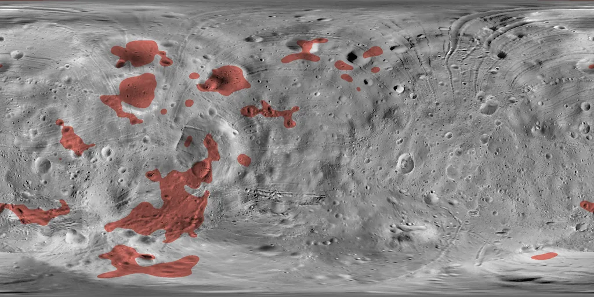 |
| io | 82,9 % | 17,1 % | 0,0 % | la de por defecto | 0,99 | — | 2,32 · 5,62 (3,27 · 7,04) | 0,43 | 2,29 (2,29) | 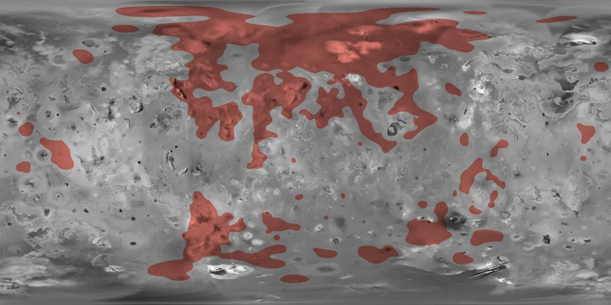 |
| europa | 80,0 % | 19,5 % | 0,5 % | la de por defecto | 0,98 | — | 1,61 · 2,10 (2,30 · 3,28) | 0,73 | 2,95 (3,05) | 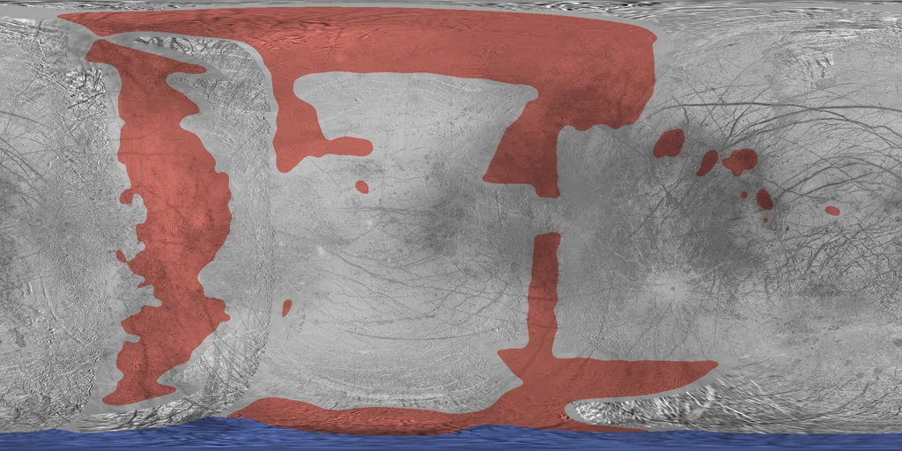 |
| ganymede | 97,9 % | 1,6 % | 0,5 % | la de por defecto | 0,97 | — | 1,72 · 2,97 (2,10 · 4,49) | 1,44 | 2,42 (2,46) | 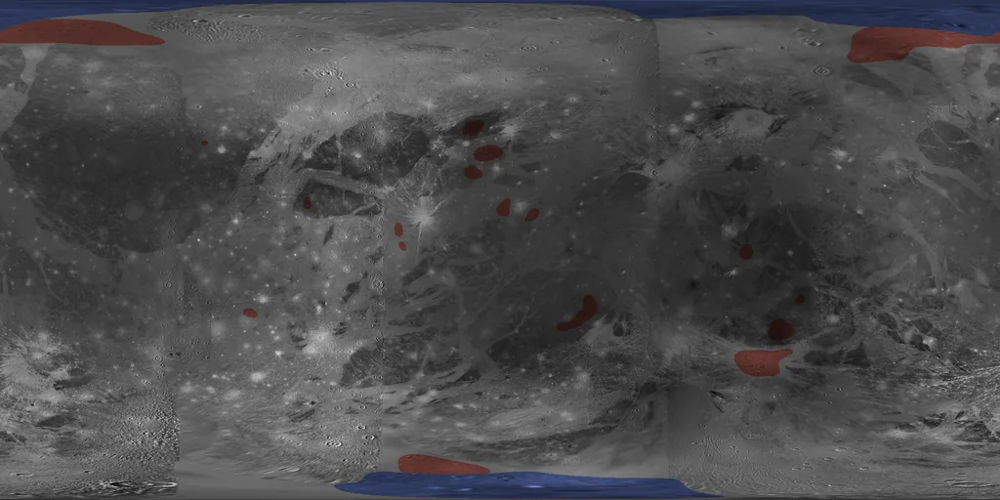 |
| callisto | 87,5 % | 11,5 % | 1,0 % | la de por defecto | 1,00 | — | 3,83 · 7,80 (5,19 · 12,72) | 0,31 | 2,68 (2,70) | 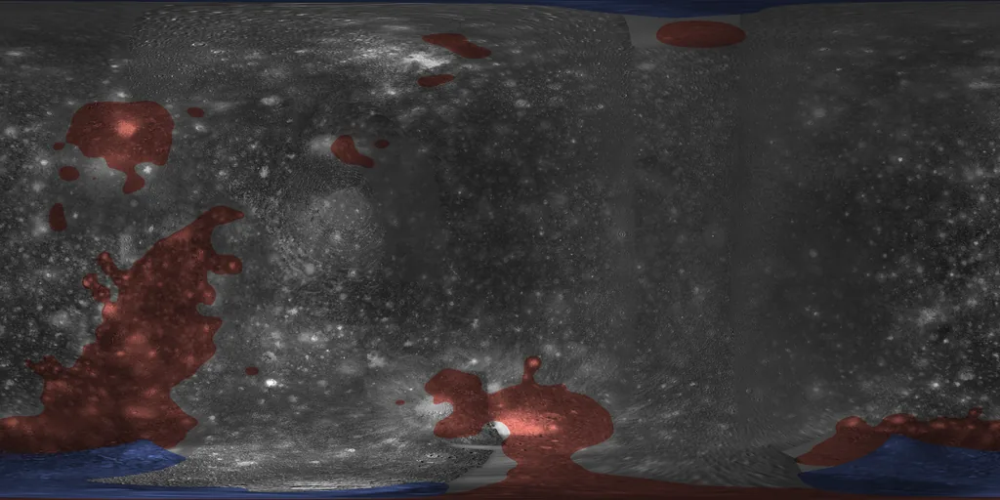 |
| mimas | 80,0 % | 20,0 % | 0,0 % | la de por defecto | 0,97 | — | 7,98 · 12,94 (11,50 · 25,96) | 0,81 | 2,50 (2,57) | 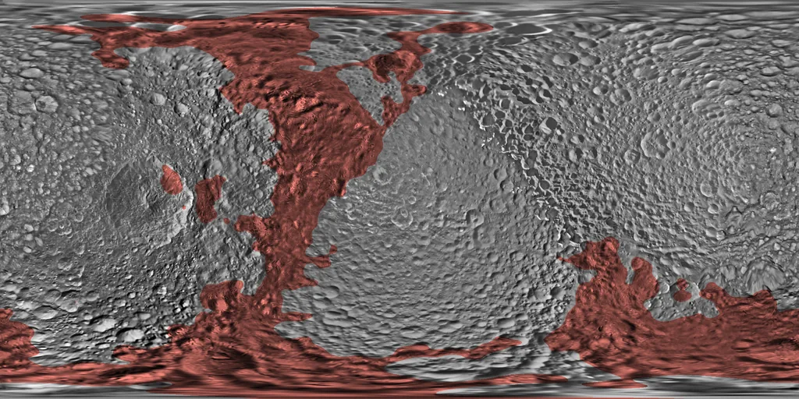 |
| enceladus | 74,1 % | 25,9 % | 0,0 % | la de por defecto | 0,98 | — | 3,44 · 6,10 (4,04 · 7,51) | 0,62 | 3,11 (3,22) | 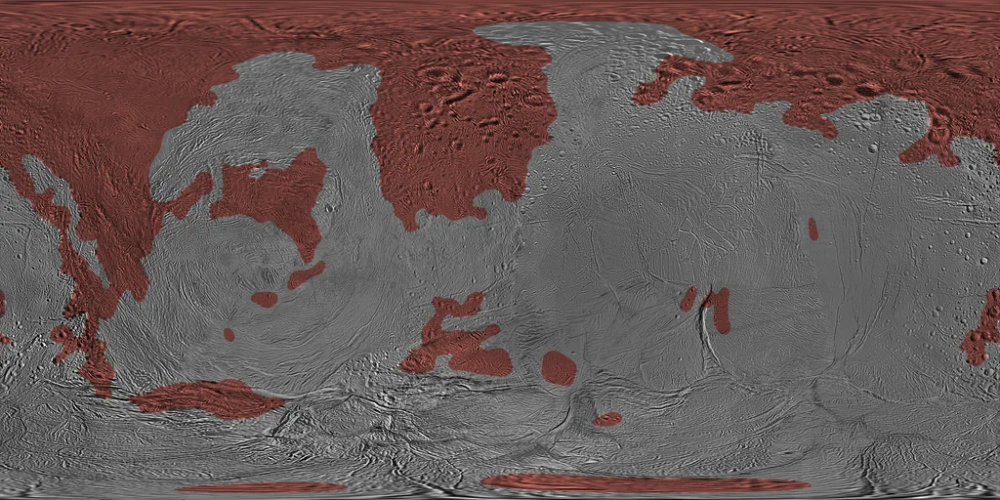 |
| tethys | 79,8 % | 20,2 % | 0,0 % | la de por defecto | 0,97 | — | 4,26 · 8,56 (8,26 · 14,84) | 0,65 | 3,02 (3,09) | 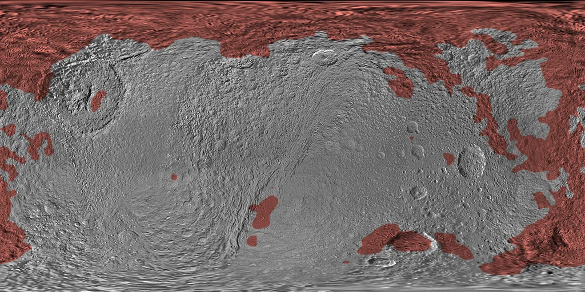 |
| dione | 87,3 % | 12,7 % | 0,0 % | la de por defecto | 0,95 | 7,98 · 7,98 (6,75 · 19,84) | 3,46 · 5,37 (5,14 · 7,27) | 1,02 | 3,11 (3,16) | 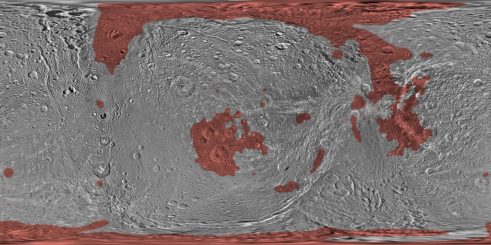 |
| rhea | 92,6 % | 7,4 % | 0,0 % | la de por defecto | 0,96 | — | 2,82 · 4,86 (4,71 · 8,65) | 0,99 | 2,71 (2,70) | 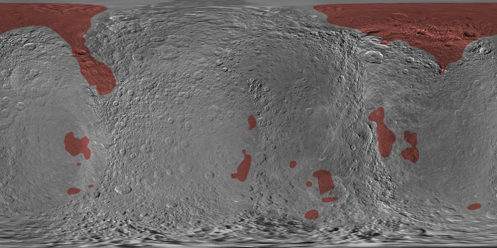 |
| iapetus | 69,2 % | 30,8 % | 0,0 % | la de por defecto | 0,96 | — | 3,89 · 11,22 (6,14 · 19,51) | 1,00 | 2,79 (2,93) | 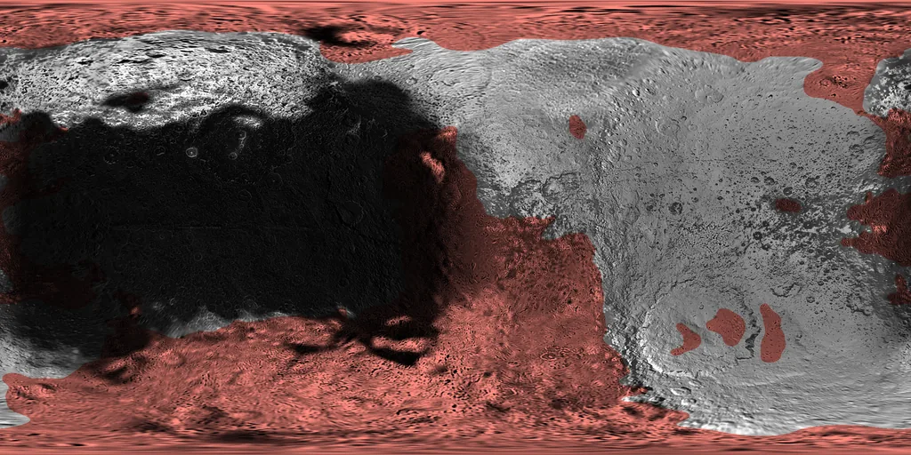 |
| triton | 30,6 % | 36,1 % | 33,4 % | el casquete de Tritón | 0,98 | 1,14 · 1,23 (5,50 · 7,52) | 3,21 · 4,52 (4,93 · 6,76) | 0,78 | 2,94 (3,25) | 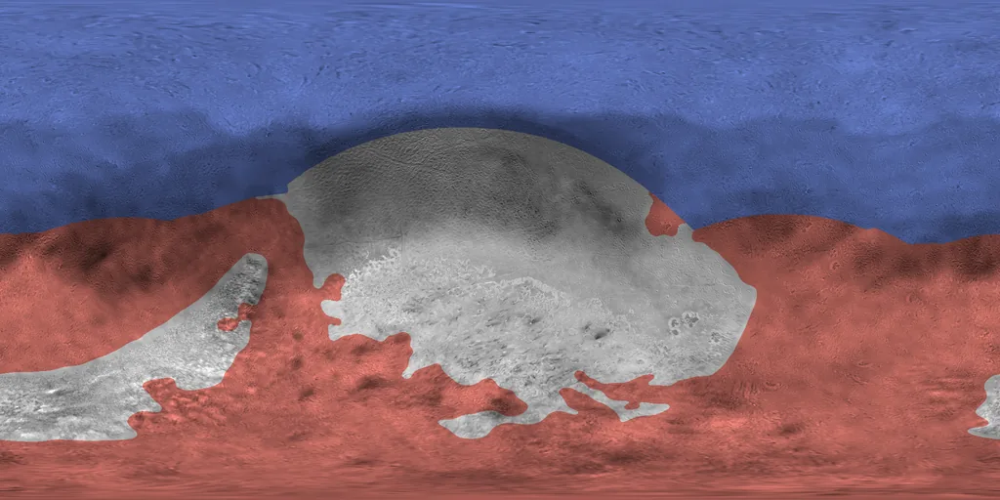 |
| deimos | 55,5 % | 32,7 % | 11,8 % | la de por defecto | 1,26 | 1,16 · 2,70 (2,74 · 5,68) | 2,50 · 3,86 (3,46 · 5,47) | 0,00 | 1,29 (1,29) | 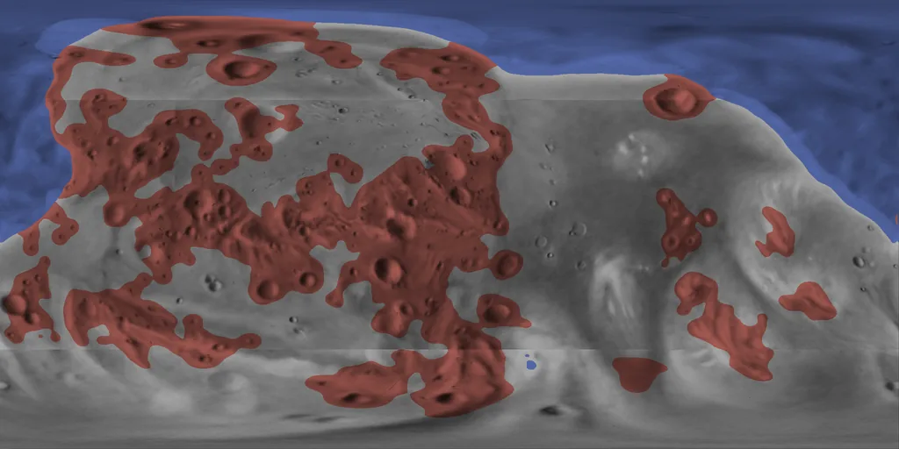 |
| miranda | 30,5 % | 8,9 % | 60,6 % | la de por defecto | 0,96 | 6,91 · 7,13 (6,64 · 21,77) | 3,09 · 6,48 (4,84 · 7,35) | 0,44 | 1,86 (1,90) | 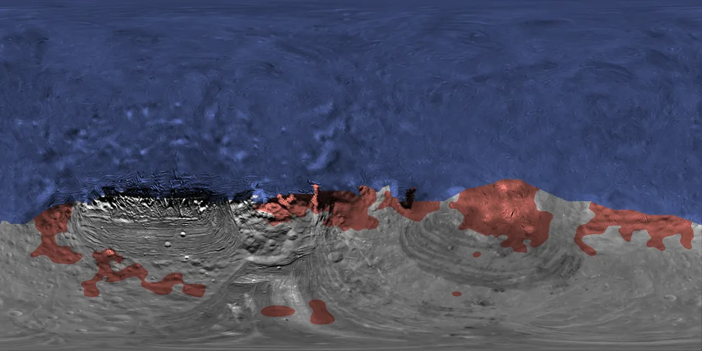 |
| ariel | 24,5 % | 8,8 % | 66,7 % | la de por defecto | 0,95 | 2,18 · 2,68 (2,44 · 6,09) | 2,47 · 2,94 (4,12 · 4,72) | 0,97 | 1,50 (1,61) | 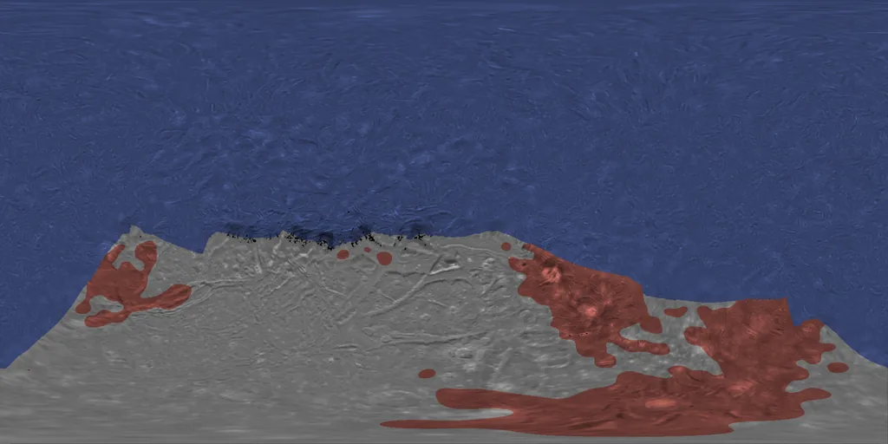 |
| umbriel | 35,3 % | 1,1 % | 63,6 % | la de por defecto | 0,95 | 1,42 · 6,98 (2,65 · 9,10) | 2,19 · 2,55 (3,14 · 3,17) | 0,85 | 1,07 (1,09) | 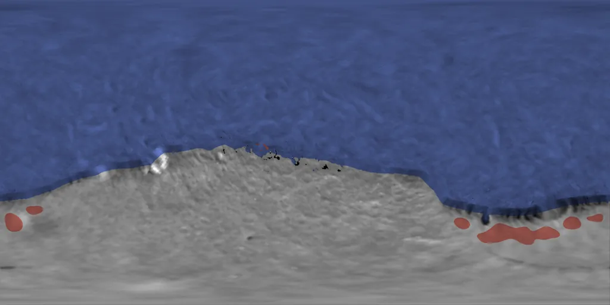 |
| titania | 30,9 % | 0,4 % | 68,6 % | la de por defecto | 0,93 | 3,65 · 7,42 (5,49 · 7,58) | 12,71 · 12,71 (16,60 · 16,60) | 1,01 | 1,82 (2,04) | 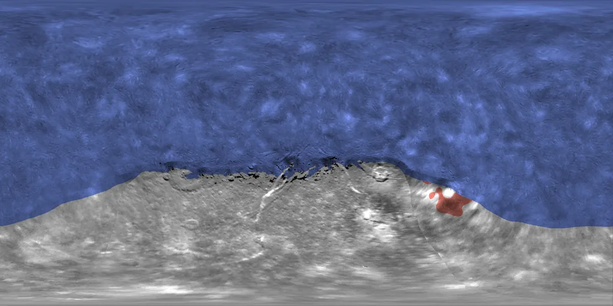 |
| oberon | 33,5 % | 0,0 % | 66,5 % | la de por defecto | 1,06 | 6,35 · 9,66 (6,38 · 14,08) | 0,72 · 0,72 (1,00 · 1,00) | 0,14 | 1,46 (1,57) | 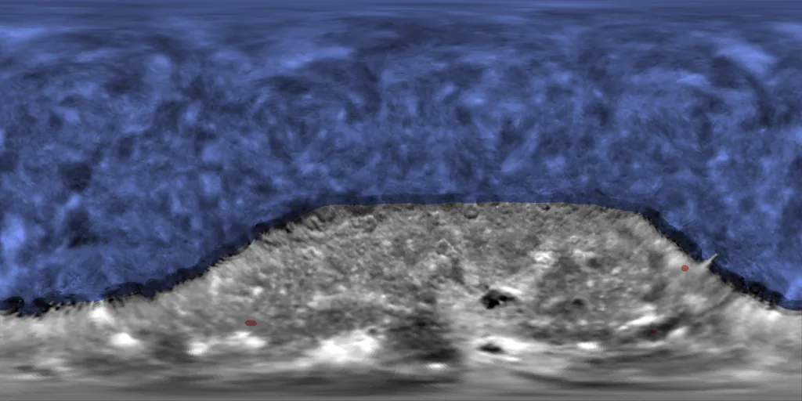 |
